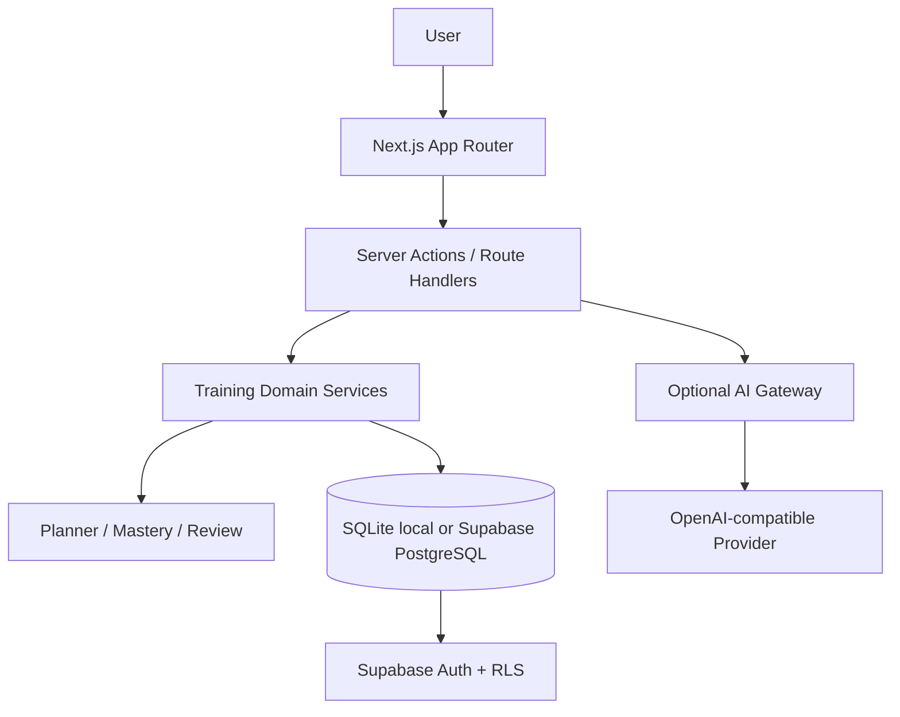

# OfferPilot

<p align="center">
  <strong>面向 Java 后端求职的个人学习与面试训练系统</strong>
</p>

<p align="center">
  
  
  
  
  
</p>

OfferPilot 将算法训练、Java 后端知识学习和模拟面试整合为一个持续运行的个人训练工作台。它不把 42 天当作进度清零点，而是围绕每日计划、练习记录、掌握度和间隔复习形成长期学习闭环。

线上演示：<https://offerpilot-dun.vercel.app>

## 核心功能

| 模块 | 功能 |
| --- | --- |
| Algorithm | LeetCode Hot 100 训练、代码草稿、提交记录、掌握度与复习安排 |
| Knowledge | Java 后端八股题库、主题筛选、Learn / Recall 主动回忆 |
| Daily Planner | 根据训练状态安排每日任务，支持暂停与恢复训练计划 |
| Knowledge Graph | 通过知识主题和前置依赖组织学习顺序 |
| Recall Review | 对照历史 Recall 结果，展示持续遗漏、新遗漏与已补齐知识点 |
| Mock Interview | 生成结构化面试题、确定性评分和能力报告；可选 AI 追问与报告解读 |
| AI Assistant | 可选代码分析、知识语义复核和面试反馈；AI 解读不覆盖确定性评分 |
| Progress | 汇总训练历史、掌握度、复习进度与学习状态 |

## 设计重点

- **确定性优先：** 训练计划、Attempt、掌握度和复习日期由规则逻辑计算；AI 负责补充解释，不作为唯一评分依据。
- **可恢复训练：** 任务与练习记录持久化，支持继续未完成训练；暂停计划不会清空历史。
- **最小化写入：** 训练接口优先返回本次增量结果，前端合并状态，避免每次操作都重新拉取完整历史。
- **本地与云端分离：** 本地开发支持 SQLite；生产数据使用 Supabase Auth、PostgreSQL 和 RLS。
- **AI Key 服务端处理：** 模型凭证不使用 `NEXT_PUBLIC_` 前缀，不交给浏览器直接调用模型服务。

## 技术架构



## 技术栈

- Next.js 16 App Router、React 19、TypeScript
- Tailwind CSS 4、shadcn/ui
- Supabase Auth、PostgreSQL、Row Level Security
- Node.js SQLite（本地持久化模式）
- OpenAI-compatible Responses / Chat API（可选）
- Vitest、ESLint、TypeScript

需要 Node.js **22.13.0 或更高版本**。

## 本地运行

### 1. 安装依赖与准备环境变量

```bash
git clone https://github.com/SuperGh2233/OfferPilot.git
cd OfferPilot
npm install
cp .env.example .env.local
```

### 2. 选择本地 SQLite 模式

在 `.env.local` 中设置：

```dotenv
LOCAL_DEMO_MODE=false
LOCAL_DATABASE_MODE=true
LOCAL_DATABASE_PATH=.offerpilot/offerpilot.sqlite
```

SQLite 文件保存在项目目录下的 `.offerpilot/`，该目录应保持在 Git 忽略范围内。首次从旧浏览器 Demo 导入数据时，请先备份原有数据。

### 3. 或配置 Supabase

云端模式使用以下变量：

```dotenv
LOCAL_DEMO_MODE=false
LOCAL_DATABASE_MODE=false
NEXT_PUBLIC_SUPABASE_URL=
NEXT_PUBLIC_SUPABASE_PUBLISHABLE_KEY=
SUPABASE_SERVICE_ROLE_KEY=
NEXT_PUBLIC_SITE_URL=http://localhost:3000
```

数据库迁移和种子数据按仓库中的 `supabase/migrations/`、Seed 脚本及 [Supabase 配置说明](docs/index.md) 执行。不要在未备份、未验证 RLS 的情况下直接对生产数据库应用迁移。

### 4. 可选：配置 AI Provider

```dotenv
OPENAI_API_KEY=
OPENAI_BASE_URL=
OPENAI_MODEL=
```

这些变量只在服务端使用。不要将 API Key 写入 `NEXT_PUBLIC_*` 变量、前端代码、截图或 Git 提交。个人 Key 设置和 Provider 选择的最新状态以 [PLAN.md](PLAN.md) 为准。

### 5. 启动

```bash
npm run dev
```

打开 <http://localhost:3000>。

## 质量检查

```bash
npm run lint
npm run typecheck
npm run test
npm run build
```

截至 2026-10-29，最近一次本地 Node 26.10 质量门记录为：ESLint、TypeScript、48 个测试文件 / 425 项测试和 Webpack 生产构建通过。该记录是本地验证，不代表最新代码已完成真实账号、真实模型网关或生产部署验收。

## 项目结构

```text
.
├── app/                 # Next.js 页面、Route Handlers 与 Server Actions
├── components/          # UI 组件
├── lib/                 # 服务端与客户端基础设施
├── app/api/             # AI 与训练相关 API
├── supabase/
│   └── migrations/      # 数据库迁移
├── docs/                # 架构、评测与实施计划
├── scripts/             # Seed、审计、Smoke 与数据库验证
├── tests/               # 自动化测试
├── PLAN.md              # 当前实施计划与状态
└── CHANGELOG.md         # 用户可见变更记录
```

## 文档

- [实施计划与当前进度](PLAN.md)
- [变更记录](CHANGELOG.md)
- [文档索引](docs/index.md)
- [数据库迁移](supabase/migrations/)

## 当前状态与限制

- 本地训练主流程、算法与知识学习、计划管理、知识图谱及模拟面试能力持续迭代中。
- 当前 AI Provider / 个人 Key 设置仍需真实账号和实际模型网关验收；本地构建通过不能替代线上验证。
- Supabase Migration、RLS、Seed 和生产部署状态以最新实施计划和实际环境核验为准，不将历史版本的验收结果视为当前版本已验收。
- AI 追问和报告解读属于辅助信息，不应取代用户对知识掌握情况的判断。

## 使用与再分发

当前仓库根目录未提供独立的 LICENSE 文件。使用或再分发前，请先确认代码来源与授权范围。
